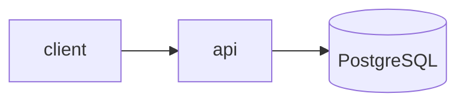

# <Name> — spec

Status: draft | agreed | building | done · Date: <yyyy-mm-dd> · Depth: full | feature
Assumptions taken without an answer: <list, or "none">

## 1. Problem and outcome
- Problem: <who has it and what they do today>
- Outcome: <what success looks like, measurable if possible>
- Not this: <what it explicitly isn't>

## 2. Users and actors
| Actor | What they do with it |
| --- | --- |

## 3. Scope
| Feature | Must / Later / No | Notes |
| --- | --- | --- |

Platforms and clients: <web, mobile, MCP, other services>
Constraints: <deadline, budget, existing data>

## 4. Features
### 4.1 <Feature>
Flow:
1. ...

Edge cases: <empty, limit, concurrency, deleted parent, no permission>

Acceptance criteria:
- [ ] <testable sentence>

## 5. Data
| Entity | Key fields | Relations | Rules (unique, limits, soft delete) |
| --- | --- | --- | --- |

## 6. Permissions
| Action | <role 1> | <role 2> | <role 3> | Public / shared |
| --- | --- | --- | --- | --- |

## 7. Architecture

- Components and where the code lives: <service / module / resources>
- API surface: <endpoints or tools, one line each>
- Background work, realtime, files, integrations: <...>
- Migrations: <new tables / columns, order>

## 8. Non-functional
- Volume and latency: <...>
- Security and privacy: <sensitive data, who must never see what>
- Must never be lost: <...>

## 9. Rollout
- <flag, backfill, deploy order, compatibility>

## 10. Tests
- <the tests that prove the acceptance criteria; levels chosen with test-strategy>

## 11. Open questions
- <question> — owner, needed by <when>

## 12. Decisions log
| Date | Decision | Why |
| --- | --- | --- |
